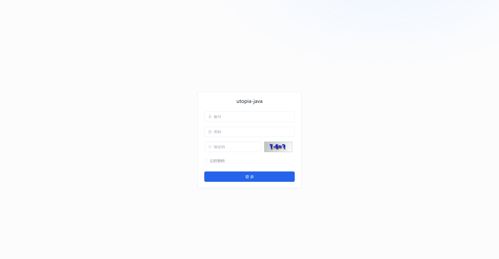
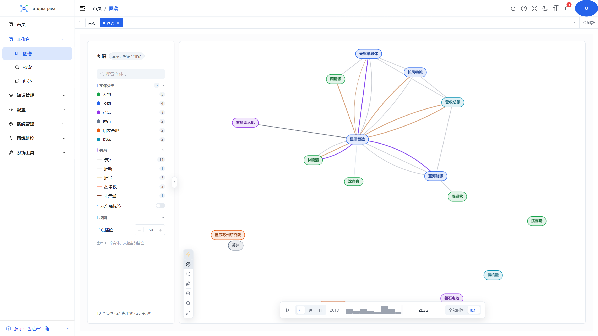
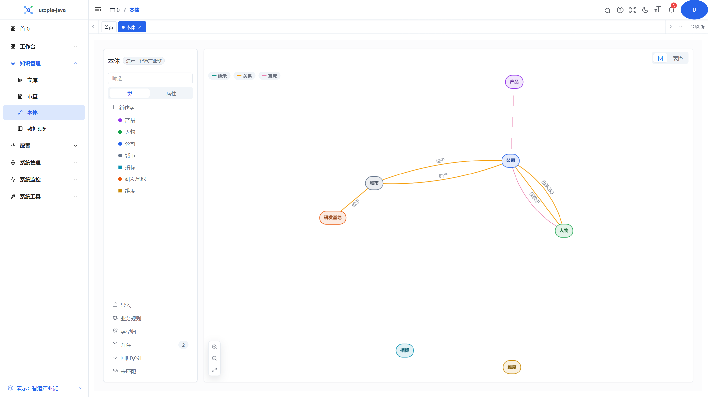
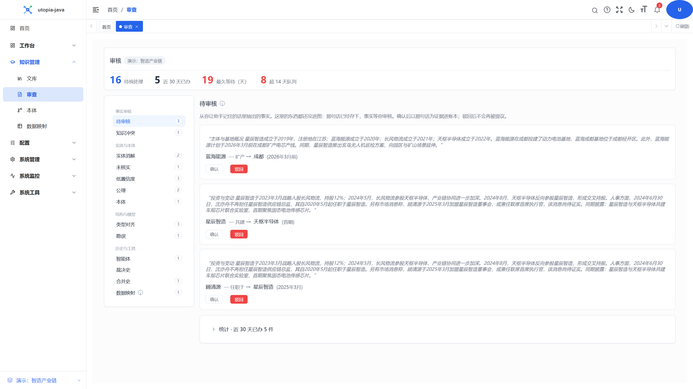
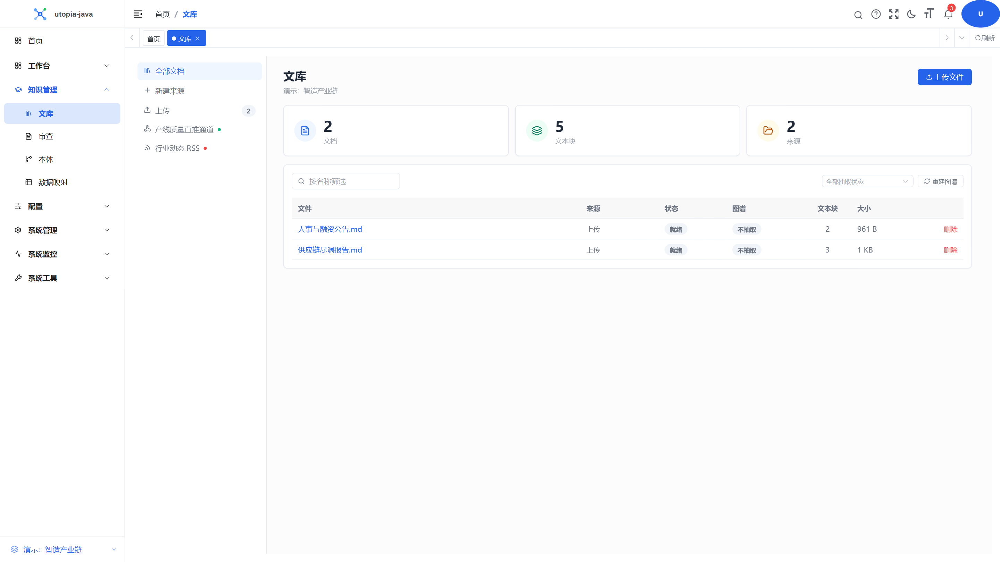
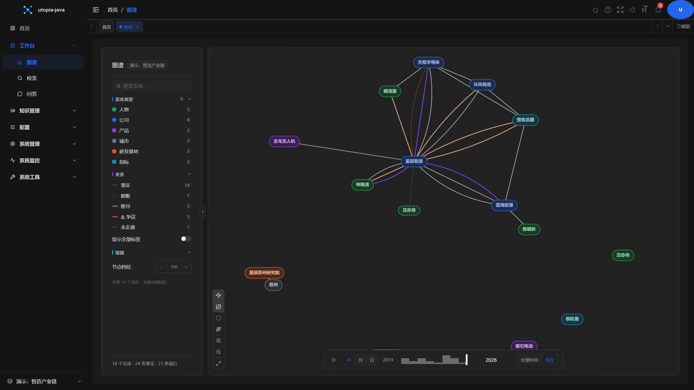
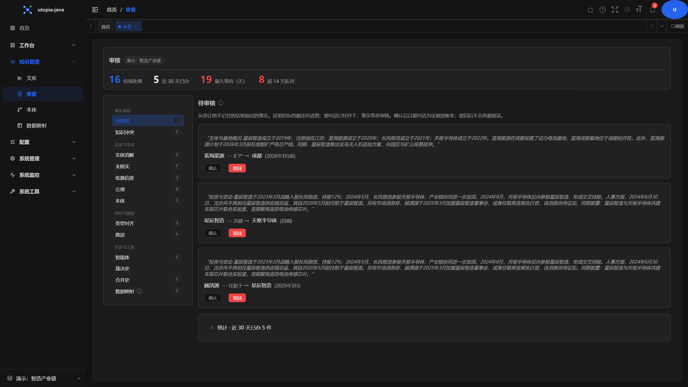
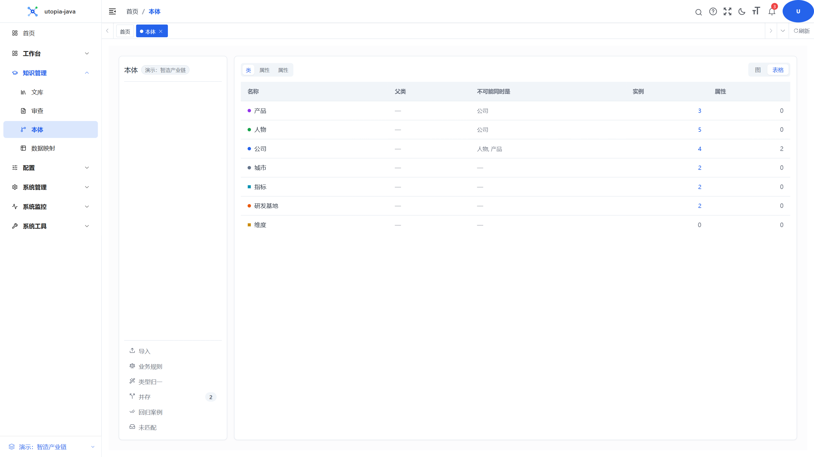
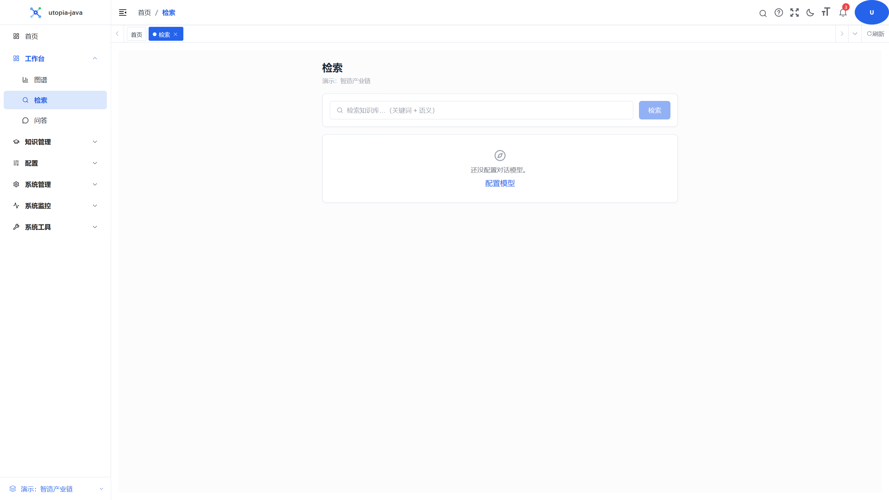

# utopia-java

**English** | [**中文**](#中文说明)

Enterprise knowledge-graph platform: ingest documents, extract entities and facts, review them, and explore them as a graph.

Built on the [RuoYi-Vue v3.9.2](https://github.com/yangzongzhuan/RuoYi-Vue) admin framework (Spring Boot + Vue 3). The knowledge-graph business logic originates from the `utopia` project and was ported onto that framework; the Maven modules keep the `jknow-` prefix for this reason.

---



## Screenshots

| Graph explorer | Ontology (schema diagram) |
|---|---|
|  |  |
| Force-directed canvas with a filter panel (entity types / relation kinds), a time-line scrubber and per-node detail. | Entity classes and their relations as an editable schema diagram. |

| Review queue | Document library |
|---|---|
|  |  |
| KPI bar, grouped queue navigation, and approve / reject right in the list. | Uploaded documents and their ingestion status. |

| Dark mode | |
|---|---|
|  |  |

<details>
<summary>More screenshots</summary>

| Ontology (table view) | Search |
|---|---|
|  |  |

</details>

## Features

- **Graph explorer** — WebGL canvas (sigma.js), force-directed / circular / type-cluster layouts, filter by entity type or relation kind, time scrubber, node budget for large libraries.
- **Ontology** — entity classes, relation types and business rules; schema diagram and table views; class hierarchy, disjointness and type alignment.
- **Review queue** — 9 queues (pending facts, duplicates, conflicts, low confidence, axiom violations, …) with single and batch decisions, plus an audit log.
- **Ingestion** — PDF / DOCX / XLSX / PPTX parsing, chunking, extraction governed by the ontology.
- **Search** — BM25 full-text (Elasticsearch + IK analyzer for Chinese) with optional vector retrieval.
- **Admin** — users, roles, menus, dictionaries, scheduled jobs (inherited from RuoYi).

## Tech stack

| Layer | Technology |
|---|---|
| Language | Java 21 |
| Backend framework | Spring Boot 4.1.2, built on RuoYi-Vue 3.9.2 |
| Persistence | PostgreSQL 16 (pgvector), MyBatis, Flyway (107 migrations) |
| Cache / session | Redis 7 |
| Search | Elasticsearch 8.14.3 + IK analyzer |
| Frontend | Vue 3.5, TypeScript 5.6, Vite 6.4 |
| UI | Element Plus 2.14, Tailwind CSS 4 |
| State / data | Pinia 4, Vue Router 4, TanStack Query 5 |
| Graph rendering | sigma.js 3, graphology |
| Testing | JUnit (250 backend test files), Vitest (32 frontend spec files) |

## Project layout

```
utopia-java
├── jknow-admin        entry module; REST controllers (/api/v1/**)
├── jknow-framework    security chain, data sources, interceptors      ┐
├── jknow-system       users / roles / menus / dictionaries            │
├── jknow-quartz       scheduled jobs                                  │ RuoYi
├── jknow-generator    code generator                                  │ skeleton
├── jknow-common       shared utilities                                ┘
├── jknow-llm          LLM client (chat + embeddings)
├── jknow-reason       ontology checks, rules, derivation
├── jknow-ingest       document parsing and chunking
├── jknow-extract      extraction, ontology agent, prompts
├── jknow-store        persistence: mappers + Flyway migrations
├── jknow-search       Elasticsearch client, BM25 / vector index
├── jknow-contract     record / replay tooling
├── jknow-web          Vue 3 frontend
├── docker/            Elasticsearch IK image
├── scripts/           smoke tests, demo data
├── sql/               schema and seed SQL
└── docs/              design specs and walkthrough reports
```

## Getting started

Prerequisites: JDK 21, Maven, Node 20+ with pnpm, Docker.

```bash
# 1) PostgreSQL / Redis / Elasticsearch
docker compose -f docker-compose.dev.yml up -d

# 2) Backend (Flyway creates the schema on first start)
mvn install -q -DskipTests -pl jknow-admin -am
JKNOW_PG_PORT=15432 SERVER_PORT=19080 JKNOW_ES_RECONCILE=1 JKNOW_JOBS_WORKER=true \
  JKNOW_DATA_DIR=$(pwd)/data \
  mvn spring-boot:run -pl jknow-admin
# health check: http://localhost:19080/api/v1/health

# 3) Demo data (optional, idempotent)
docker compose -f docker-compose.dev.yml exec -T pg psql -U postgres -d jknow \
  -v ON_ERROR_STOP=1 -q -f - < scripts/seed-demo.sql
# Restart the backend afterwards so the search index is rebuilt.

# 4) Frontend
cd jknow-web
pnpm install
pnpm dev
```

Then open http://localhost and sign in with `admin` / `admin123` (demo account created by `seed-demo.sql`).

Notes:

- `JKNOW_DATA_DIR` must point at the repository's `data/` directory; otherwise the backend creates a second `secret.key` under `jknow-admin/` and search returns 500.
- Without `JKNOW_JOBS_WORKER=true` uploaded documents stay in "queued".
- Chat and semantic search need an LLM configured first (Admin → Models). Until then, search falls back to BM25 keywords.

## Verification

```bash
./scripts/smoke-p0.sh    # admin surface, 20 assertions
./scripts/smoke-p1.sh    # business surface, 67 pass + 1 skip
```

## License

[MIT](LICENSE). The RuoYi framework is MIT-licensed; see `LICENSE`.

---
---

# 中文说明

企业级知识图谱平台：导入文档、抽取实体与事实、人工审核、以图谱方式浏览与探索。

基于 [RuoYi-Vue v3.9.2](https://github.com/yangzongzhuan/RuoYi-Vue) 后台框架（Spring Boot + Vue 3）开发。知识图谱业务源自 `utopia` 项目并移植到该框架之上，因此 Maven 模块沿用 `jknow-` 前缀。

---


## 截图

| 图谱浏览 | 本体（模式图） |
|---|---|
|  |  |
| 力导向画布，左侧筛选面板（实体类型 / 关系类别）、时间轴、节点详情。 | 实体类及其关系，可编辑的模式图。 |

| 审核队列 | 文库 |
|---|---|
|  |  |
| KPI 概览条、分组队列导航，列表内直接确认 / 驳回。 | 已上传文档及其摄取状态。 |

| 暗色模式 | |
|---|---|
|  |  |

<details>
<summary>更多截图</summary>

| 本体（表格视图） | 检索 |
|---|---|
|  |  |

</details>

## 功能

- **图谱浏览** — WebGL 画布（sigma.js），力导向 / 环形 / 类型聚簇布局，按实体类型或关系类别筛选，时间轴，大库的节点档位。
- **本体** — 实体类、关系类型、业务规则；模式图与表格两种视图；类层级、互斥、类型对齐。
- **审核队列** — 9 个队列（待审核、重复、冲突、低置信度、公理违规……），支持单条与批量裁决，附裁决台账。
- **文档摄取** — PDF / DOCX / XLSX / PPTX 解析、分块、受本体约束的抽取。
- **检索** — BM25 全文（Elasticsearch + IK 中文分词），可选向量检索。
- **系统管理** — 用户、角色、菜单、字典、定时任务（继承自 RuoYi）。

## 技术栈

| 层 | 技术 |
|---|---|
| 语言 | Java 21 |
| 后端框架 | Spring Boot 4.1.2，基于 RuoYi-Vue 3.9.2 |
| 持久化 | PostgreSQL 16（pgvector）、MyBatis、Flyway（107 个迁移） |
| 缓存 / 会话 | Redis 7 |
| 检索 | Elasticsearch 8.14.3 + IK 分词 |
| 前端 | Vue 3.5、TypeScript 5.6、Vite 6.4 |
| UI | Element Plus 2.14、Tailwind CSS 4 |
| 状态 / 数据 | Pinia 4、Vue Router 4、TanStack Query 5 |
| 图谱渲染 | sigma.js 3、graphology |
| 测试 | JUnit（后端 250 个测试文件）、Vitest（前端 32 个 spec） |

## 目录结构

```
utopia-java
├── jknow-admin        启动模块；REST 控制器（/api/v1/**）
├── jknow-framework    安全链、数据源、拦截器                    ┐
├── jknow-system       用户 / 角色 / 菜单 / 字典                  │
├── jknow-quartz       定时任务                                    │ RuoYi
├── jknow-generator    代码生成                                    │ 骨架
├── jknow-common       通用工具                                    ┘
├── jknow-llm          LLM 客户端（对话 + 向量）
├── jknow-reason       本体检查、规则、推导
├── jknow-ingest       文档解析与分块
├── jknow-extract      抽取、本体 agent、提示词
├── jknow-store        持久化：mapper + Flyway 迁移
├── jknow-search       Elasticsearch 客户端、BM25 / 向量索引
├── jknow-contract     录制 / 回放工装
├── jknow-web          Vue 3 前端
├── docker/            Elasticsearch IK 镜像
├── scripts/           冒烟测试、演示数据
├── sql/               建表与初始化 SQL
└── docs/              设计规格与走查报告
```

## 快速开始

前置：JDK 21、Maven、Node 20+ 与 pnpm、Docker。

```bash
# 1) PostgreSQL / Redis / Elasticsearch
docker compose -f docker-compose.dev.yml up -d

# 2) 后端（首次启动时 Flyway 自动建表）
mvn install -q -DskipTests -pl jknow-admin -am
JKNOW_PG_PORT=15432 SERVER_PORT=19080 JKNOW_ES_RECONCILE=1 JKNOW_JOBS_WORKER=true \
  JKNOW_DATA_DIR=$(pwd)/data \
  mvn spring-boot:run -pl jknow-admin
# 健康检查：http://localhost:19080/api/v1/health

# 3) 演示数据（可选，幂等）
docker compose -f docker-compose.dev.yml exec -T pg psql -U postgres -d jknow \
  -v ON_ERROR_STOP=1 -q -f - < scripts/seed-demo.sql
# 灌完后重启后端，以重建检索索引。

# 4) 前端
cd jknow-web
pnpm install
pnpm dev
```

打开 http://localhost，用 `admin` / `admin123` 登录（`seed-demo.sql` 创建的演示账号）。

注意：

- `JKNOW_DATA_DIR` 必须指向仓库根的 `data/`；否则后端会在 `jknow-admin/` 下另生成一份 `secret.key`，导致检索返回 500。
- 不带 `JKNOW_JOBS_WORKER=true` 时，上传的文档会一直停在"排队中"。
- 对话与语义检索需先配置大模型（管理 → 模型）。未配置时检索退回 BM25 关键词。

## 验证

```bash
./scripts/smoke-p0.sh    # 管理面，20 条断言
./scripts/smoke-p1.sh    # 业务面，67 通过 + 1 跳过
```

## 许可证

[MIT](LICENSE)。RuoYi 框架同为 MIT 许可，见 `LICENSE`。
